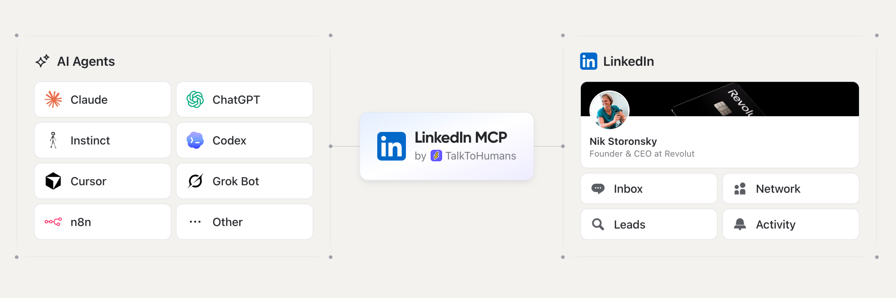

<a href="https://www.talktohumans.app/?utm_source=github&utm_medium=readme&utm_campaign=linkedin-cli"></a>

# LinkedIn CLI

**The safest LinkedIn CLI for your agents.**

`tth` connects Claude Code, Codex, Cursor or any agent with a terminal to your own LinkedIn account. No MCP tool definitions loaded into every session: your agent reads `--help` when it needs a command.

Your agent reads your LinkedIn conversations, searches your network, enriches profiles with email and phone, and drafts the messages. You review them and hit send.

[](https://www.talktohumans.app/?utm_source=github&utm_medium=readme&utm_campaign=linkedin-cli)
[](https://www.talktohumans.app/docs/developers/cli)
[](https://github.com/TalkToHumans/linkedin-cli/releases/latest)
[](#set-up-your-ai-agent)
[](https://github.com/TalkToHumans/linkedin-cli/releases/latest)

## Why this LinkedIn CLI is safer

LinkedIn has no official CLI, and its public API doesn't give access to your private messages. Every LinkedIn CLI is third-party, and most fall into one of three groups:

| | Open-source scrapers | Cloud LinkedIn tools | TalkToHumans |
|---|---|---|---|
| Pace | Whatever pace your agent sets | Daily caps sized for campaigns | Human pace, enforced: daily limits plus a gap between every action, per LinkedIn account. Nobody can override them |
| What 100 agent calls do | 100 trips to LinkedIn | 100 trips to LinkedIn, from their servers | Read a synced cache, so no more LinkedIn activity than one call |
| Where LinkedIn actions run | A script driving a browser on your machine | Their servers, often behind proxy IPs | The browser you already use. No cloud automation, no proxy IP |
| Where you work | In your terminal | In your terminal | Wherever suits the task: your terminal, the TalkToHumans app, or right inside LinkedIn and Sales Navigator |
| Who presses send | Usually the agent | The agent or a campaign | You. The CLI only drafts |

No LinkedIn tool is completely risk-free. Here is how TalkToHumans keeps the risk down:

- **Human pace, enforced.** Every action type has its own conservative daily limit and a slightly random gap between actions, so nothing goes out in bursts. Limits belong to the LinkedIn account, so every teammate and every agent shares them. Nobody can raise them, not even your agent.
- **Cache-based sync.** Your agent reads a synced copy of your LinkedIn data, not LinkedIn itself. Run 100 commands on your inbox and your account sees the same activity as one, with no hopping from profile to profile. The background sync that fills that copy is paced the same way.
- **Posts and searches skip your account.** Posts, comments, the people engaging with them and people searches come from a data provider, never from your LinkedIn session.
- **Runs in your browser.** LinkedIn actions go through the browser you already use. No cloud automation, no proxy IPs and no virtual browsers acting on your behalf.
- **Work in the terminal, the app or LinkedIn.** Everything your agent does also lands in the TalkToHumans app and in panels embedded in LinkedIn's own pages. Check conversations, see what's scheduled and take over by hand wherever you are.
- **Drafts only.** `tth` can write a reply or stage a full follow-up sequence. No command sends a message: nothing goes out until you hit send.

## What your agent can do on LinkedIn

Founders, consultants, sales teams and agencies use it for the same handful of jobs:

- **Find leads in your network.** Describe your ideal customer, and your agent scores your connections. They're already connected to you, so you can message them today.
- **Find the replies you owe.** Scan hundreds of LinkedIn, Sales Navigator and Recruiter threads for the ones where someone is waiting on you, every morning if you like.
- **Draft messages in your voice.** Your agent researches each person and writes a first message that sounds like you. You review every draft and send it yourself.
- **See what gets replies.** Analyze acceptance rates, reply rates and templates, from connection request to booked meeting.
- **Stage follow-up sequences.** Follow-ups that stop when the lead replies, written for each person, waiting for you to launch them.
- **Import new leads.** Search LinkedIn by role, company or location, or bring in a list from an event or Sales Navigator, and get a ready-to-work view.
- **Mine post comments.** Find posts on a topic or by a competitor, and import the people who commented or reacted, each with a signal saying how.
- **Score and tag contacts.** Fill an ICP score for every contact, or backfill tags on hundreds of conversations the way your team already uses them.
- **Keep your CRM in sync.** Combine it with your CRM's CLI or MCP to log LinkedIn conversations, or use the native HubSpot integration.
- **Script it.** Pipe JSON into `jq`, run a weekly report from cron, or wire LinkedIn into your own tools.

Your agent also gets work email and mobile phone for the people you talk to, from 20+ providers in a waterfall.

## Quickstart

```bash
# Install (macOS and Linux)
brew install talktohumans/tap/tth

# Sign in (opens a browser)
tth auth login

# List your contacts
tth contacts list --query "Acme"
```

On Windows or without Homebrew, download `tth` from the [latest release](https://github.com/TalkToHumans/linkedin-cli/releases/latest) and put it on your `PATH`.

Scripts and cron jobs sign in with an API key instead: set `TTH_API_KEY` to a key a workspace admin creates in TalkToHumans Settings.

## Set up your AI agent

Install the agent skill once:

```bash
tth skill --install
```

Or with any skills installer: `npx skills add TalkToHumans/linkedin-cli`

## Common commands

```bash
# Conversations where you owe a reply
tth conversations list --account-id 42 --filters '[{"field":"conversation.reply_state","operator":"=","value":"waiting_for_my_reply"}]'

# Import profiles and wait for the result
tth contacts import --account-id 42 --file leads.txt --wait

# Enrich and tag a contact
tth contacts enrich --contact-id 123
tth contacts update 123 --tag "Hot lead"

# Draft a message (never sent)
tth drafts write --account-id 42 --contact-id 123 --draft-message "Hi Ada, ..."

# Last week's performance
tth activity summary --from 2026-10-19 --to 2026-10-25
```

Every command supports `--help`, starting with real examples:

```bash
tth contacts --help
tth drafts write --help
```

## LinkedIn CLI commands

| Area | Commands |
|---|---|
| Auth | `tth auth login`, `tth auth status`, `tth auth logout` |
| Accounts | `tth accounts list`, `tth credits show` |
| Conversations | `tth conversations list`, `tth messages list`, `tth drafts write` |
| Contacts | `tth contacts list`, `import`, `import-status`, `update`, `delete`, `tth people search`, `tth signals create`, `tth fields list`, `create`, `tth tags list`, `update`, `delete` |
| Companies | `tth companies list` |
| Content | `tth content list`, `search`, `find`, `import`, `import-engagers`, `track`, `update` |
| Enrichment | `tth contacts enrich`, `find-email`, `find-phone` |
| Views | `tth views list`, `create`, `update` |
| Templates & sequences | `tth templates list`, `create`, `update`, `tth sequences update`, `delete` |
| Reporting | `tth activity list`, `tth activity summary` |
| Agents | `tth skill`, `tth skills list`, `tth skills show`, `tth feedback send` |
| Anything else | `tth api <METHOD> /v1/...` |

`tth drafts write` saves a draft or stages a sequence for you to review. It never sends. Imports, searches, enrichment and tracking use TalkToHumans credits. `tth accounts list --json` also gives your agent your own LinkedIn profile, for free, so it knows who you are.

## LinkedIn CLI or LinkedIn MCP?

Both reach the same workspace with the same safety rules and the same playbooks. Pick by where your agent runs:

| | [LinkedIn CLI](https://github.com/TalkToHumans/linkedin-cli) | [LinkedIn MCP](https://github.com/TalkToHumans/linkedin-mcp) |
|---|---|---|
| Best for | Terminal agents (Claude Code, Codex, Cursor), scripts and cron | Chat apps (Claude, ChatGPT), n8n and any remote MCP client |
| Context cost | Only the commands your agent runs, and `--help` when it needs it | Every tool definition, in every session |
| Login | `tth auth login` in the browser, or an API key | OAuth when you add the connector |

Many people use both: the MCP in their chat app, the CLI in their terminal. To connect Claude, ChatGPT or another chat app (Claude is one click), follow the [MCP setup guide](https://www.talktohumans.app/docs/developers/mcp).

## FAQ

### What is a LinkedIn CLI?

A command-line tool for LinkedIn. You, a script or an AI agent run commands like `tth conversations list` in a terminal and get your LinkedIn data back as a table or JSON, instead of opening LinkedIn in a browser tab.

### Is there a LinkedIn CLI?

LinkedIn doesn't offer an official one, and its public API doesn't cover private messages. `tth` is a third-party LinkedIn CLI by TalkToHumans that works on your own account: conversations, network, contacts, enrichment, drafts and reports.

### Why a CLI when there is an MCP?

MCP tool definitions are loaded into your agent's context in every session and every subagent. A CLI costs tokens only when your agent calls it, and its help is read on demand. It also runs in scripts and cron jobs, where no agent is involved.

### Can my agent send LinkedIn messages on its own?

No, and that's on purpose. Your agent can read, sort and draft, down to a full follow-up sequence. Every message that carries your name still gets your approval.

### Do I have to give you my LinkedIn password?

No. TalkToHumans works through your logged-in browser session. `tth` signs in to TalkToHumans, not to LinkedIn, and stores its login in `~/.config/talktohumans/`, readable by you only.

### How fresh is the data?

Your workspace syncs while your browser is open with the TalkToHumans extension on, newest conversations first. Older message history loads when you open a conversation in TalkToHumans. `tth messages list` warns on stderr when a conversation isn't fully synced.

### Which plan includes the CLI?

The CLI, the MCP and the API come with every paid plan, from [Starter](https://www.talktohumans.app/pricing?utm_source=github&utm_medium=readme&utm_campaign=linkedin-cli). Pro adds sequences, post engagers, analytics and CRM integrations.

## About this repository

This repo holds the `tth` release binaries, the agent skill (`skills/talktohumans-linkedin/`) and this documentation. The Homebrew formula lives in [homebrew-tap](https://github.com/TalkToHumans/homebrew-tap). `tth` talks to the hosted TalkToHumans API at `https://api.talktohumans.app/v1`, and its source code isn't in this repo.

Found a bug or a missing command? [Open an issue](https://github.com/TalkToHumans/linkedin-cli/issues), or run `tth feedback send`.

---

Built by [TalkToHumans](https://www.talktohumans.app/?utm_source=github&utm_medium=readme&utm_campaign=linkedin-cli).
