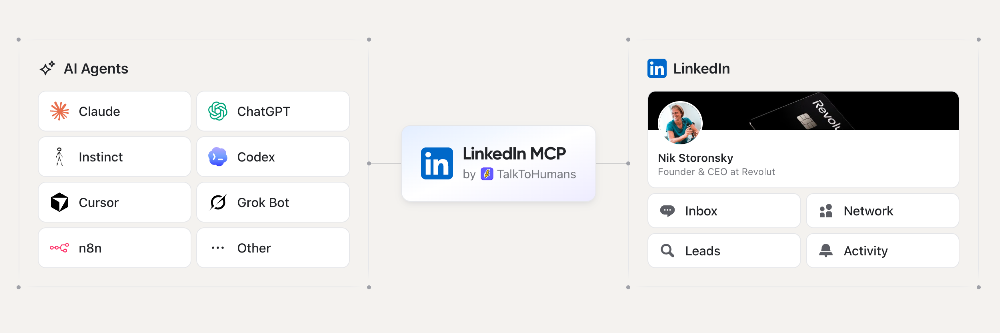

<a href="https://www.talktohumans.app/?utm_source=github&utm_medium=readme&utm_campaign=linkedin-cli"></a>

# LinkedIn CLI

**The safest LinkedIn CLI for your agents.**

`tth` connects Claude Code, Codex, Cursor or any agent with a terminal to your own LinkedIn account. No MCP tool definitions loaded into every session: your agent reads `--help` when it needs a command.

Your agent reads your LinkedIn conversations, searches your network, enriches profiles with email and phone, and drafts the messages. You review them and hit send.

[](https://www.talktohumans.app/?utm_source=github&utm_medium=readme&utm_campaign=linkedin-cli)
[](https://www.talktohumans.app/docs/developers/cli)
[](https://github.com/TalkToHumans/linkedin-cli/releases/latest)
[](#for-ai-agents)
[](https://github.com/TalkToHumans/linkedin-cli/releases/latest)

```bash
brew install talktohumans/tap/tth
tth auth login
tth contacts list --query "Acme"
```

No Homebrew, or on Windows? Download the archive for your system from the [latest release](https://github.com/TalkToHumans/linkedin-cli/releases/latest) and put `tth` on your `PATH`.

## Why this LinkedIn CLI is safer

LinkedIn has no official CLI, and its public API doesn't give access to your private messages. Every LinkedIn CLI is third-party, and most fall into one of three groups:

| | Open-source scrapers | Cloud LinkedIn tools | TalkToHumans |
|---|---|---|---|
| Pace | Whatever pace your agent sets | Daily caps sized for campaigns | Human pace, enforced: daily limits plus a gap between every action, per LinkedIn account. Nobody can override them |
| What 100 agent calls do | 100 trips to LinkedIn | 100 trips to LinkedIn, from their servers | Read a synced cache, so no more LinkedIn activity than one call |
| Where LinkedIn actions run | A script driving a browser on your machine | Their servers, often behind proxy IPs | The browser you already use. No cloud automation, no proxy IP |
| Where you work | In your terminal | In your terminal | Wherever suits the task: your terminal, the TalkToHumans app, or right inside LinkedIn and Sales Navigator |
| Who presses send | Usually the agent | The agent or a campaign | You. The CLI only drafts |

No LinkedIn tool is completely risk-free. Here is how TalkToHumans keeps the risk down:

- **Human pace, enforced.** Every action type has its own conservative daily limit and a slightly random gap between actions, so nothing goes out in bursts. Limits belong to the LinkedIn account, so every teammate and every agent shares them. Nobody can raise them, not even your agent.
- **Cache-based sync.** Your agent reads a synced copy of your LinkedIn data, not LinkedIn itself. Run 100 commands on your inbox and your account sees the same activity as one, with no hopping from profile to profile. The background sync that fills that copy is paced the same way.
- **Runs in your browser.** LinkedIn actions go through the browser you already use. No cloud automation, no proxy IPs and no virtual browsers acting on your behalf.
- **Work in the terminal, the app or LinkedIn.** Everything your agent does also lands in the TalkToHumans app and in panels embedded in LinkedIn's own pages. Check conversations, see what's scheduled and take over by hand wherever you are.
- **Drafts only.** `tth` can write a reply or stage a full follow-up sequence. No command sends a message: nothing goes out until you hit send.

## What your agent can do on LinkedIn

Founders, consultants, sales teams and agencies use it for the same handful of jobs. Each one has a ready-to-paste prompt [further down](#linkedin-cli-use-cases-and-prompts).

- **[Find leads in your network.](#find-leads-in-your-linkedin-network)** Describe your ideal customer, and your agent scores your connections. They're already connected to you, so you can message them today.
- **[Find the replies you owe.](#find-the-linkedin-replies-you-owe)** Scan hundreds of LinkedIn, Sales Navigator and Recruiter threads for the ones where someone is waiting on you, every morning if you like.
- **[Draft messages in your voice.](#draft-linkedin-messages-in-your-voice)** Your agent researches each person and writes a first message that sounds like you. You review every draft and send it yourself.
- **[See what gets replies.](#analyze-your-linkedin-outbound-performance)** Analyze acceptance rates, reply rates and templates, from connection request to booked meeting.
- **[Stage follow-up sequences.](#stage-linkedin-follow-up-sequences)** Follow-ups that stop when the lead replies, written for each person, waiting for you to launch them.
- **[Import new leads.](#find-new-leads-online-and-import-them)** Find people showing intent online, or bring in a list from an event or Sales Navigator, and get a ready-to-work view.
- **[Score and tag contacts.](#score-contacts-against-your-icp)** Fill an ICP score for every contact, or backfill tags on hundreds of conversations the way your team already uses them.
- **[Keep your CRM in sync.](#log-linkedin-conversations-in-your-crm)** Combine it with your CRM's CLI or MCP to log LinkedIn conversations, or use the native HubSpot integration.
- **[Script it.](#script-linkedin-with-tth)** Pipe JSON into `jq`, run a weekly report from cron, or wire LinkedIn into your own tools.

Your agent also gets work email and mobile phone for the people you talk to, from 20+ providers in a waterfall.

## Install and log in

You need a TalkToHumans account on the Pro plan, with the TalkToHumans browser extension connected to LinkedIn. [Try it free](https://app.talktohumans.app/?auth=signup&utm_source=github&utm_medium=readme&utm_campaign=linkedin-cli).

1. Install: `brew install talktohumans/tap/tth` on macOS and Linux, or download a binary from [Releases](https://github.com/TalkToHumans/linkedin-cli/releases/latest) (macOS, Linux and Windows, Intel and ARM).
2. Log in: `tth auth login` shows a one-time code and opens TalkToHumans in your browser to confirm it.
3. Check: `tth auth status` shows your workspace, and `tth accounts list` your connected LinkedIn accounts.

Scripts and cron jobs have no one to confirm in a browser: give them an API key with `TTH_API_KEY` (a workspace admin creates it in TalkToHumans Settings).

```bash
export TTH_API_KEY=sk_...
tth credits show
```

## For AI agents

Install the skill once. It teaches your agent when to use `tth`, how its output works and where the playbooks are:

```bash
tth skill --install
```

That writes it to `~/.claude/skills/` (Claude Code) and `~/.agents/skills/` (Codex and other agents). You can also install it from this repo with any skills installer:

```bash
npx skills add TalkToHumans/linkedin-cli
```

```bash
gh skill install TalkToHumans/linkedin-cli talktohumans-linkedin --scope user
```

Then ask in plain words, like the prompts below. Your agent:

1. Runs `tth skills show ground-rules` and follows it for every task.
2. Picks the playbook that matches your request from `tth skills list` (reply triage, list imports, ICP scoring, weekly reports and more). They're the same playbooks as the [LinkedIn MCP](https://github.com/TalkToHumans/linkedin-mcp), served by the API, so they stay current without updating the CLI.
3. Reads `tth <command> --help` before a command it hasn't used. Every help page starts with real examples.

What the agent can rely on:

- **stdout is data only.** JSON when piped, a table in a terminal, `--json` to force JSON. `--all` follows pagination and prints one JSON array.
- **stderr carries warnings and errors.** Errors are JSON when piped: `{"code","message","hint"}`.
- **Exit codes:** `0` ok, `1` error, `2` usage, `3` not found, `4` auth, plan or setup, `5` rate limited.
- **No prompts without a terminal.** Deleting a tag or a sequence needs `--yes` when there is no one to ask.

## LinkedIn CLI use cases and prompts

Replace the parts in `[brackets]`. Each prompt works in Claude Code, Codex, Cursor or any agent with a terminal once `tth` is logged in and the skill installed. They're ordered from the ones people run most.

### Find leads in your LinkedIn network

At least 10–20 people in your network probably already fit your ICP, and you can message them without a connection request.

```txt
Use the tth CLI to find up to 20 leads in my LinkedIn network
I should reach out to today for [BUSINESS NAME].

My ICP is: [DESCRIBE YOUR ICP]

Then create a view in TalkToHumans with those 20 leads so I can work through them today.
```

To find intro paths instead, ask for people who could introduce you to your ICP, why each one is relevant, and a draft of the intro ask.

### Find the LinkedIn replies you owe

Leads rarely go cold because they said no. They go cold because nobody answered.

```txt
Use the tth CLI to go through my LinkedIn conversations.
List every thread where the other person wrote last and I haven't answered,
most important first. Draft a reply for each one. Don't send anything.
```

Run it every morning for a LinkedIn inbox brief (see [Script LinkedIn with tth](#script-linkedin-with-tth)). Your agent reads the inbox synced by the TalkToHumans extension, so keep LinkedIn open in your browser for the latest messages.

### Draft LinkedIn messages in your voice

A good first message is the hardest part. Your agent gets you past the blank page, and every draft waits in TalkToHumans until you review and send it.

```txt
Use the tth CLI and open the contacts in this view:
[LINK TO THE CONTACT VIEW IN TALKTOHUMANS]

Draft a first message for each of them.

Rules:
- Max 3 sentences.
- No pitch in the first message. Open a real conversation.
- Use their profile or our past conversation to show you know something
  true and specific about their world. No fake flattery.
- Match their tone, based on how they write or how their profile reads.
- Ask yourself: "Would I reply to this if I were them?" If not, rewrite it.
- Review your output with https://github.com/hardikpandya/stop-slop/blob/main/SKILL.md

I'll review each message before sending.
```

### Analyze your LinkedIn outbound performance

```txt
Use the tth CLI to analyze my LinkedIn outbound performance over the past 2 weeks.
Work out what tends to work and what doesn't, from accepted connection request
to booked meeting. Then tell me what to change, improve or stop doing for the next 2 weeks.

Add charts where they make the analysis easier to read.
```

### Stage LinkedIn follow-up sequences

Most replies come from the follow-up, and writing three of them for every lead is where most people give up. Your agent stages each [sequence](https://www.talktohumans.app/docs/product/messaging/sequences) as a draft. It stops as soon as the lead replies, and nothing starts until you launch it.

```txt
Use the tth CLI to find the contacts who accepted my connection request
in the last 30 days but never replied.

For each one, stage a 2-step follow-up sequence as a draft:
- Day 3: a short follow-up that adds one useful, specific thing for them
- Day 10: a light last nudge

Same rules as a first message: short, no pitch, specific to them.
I'll review and launch each sequence myself.
```

### Find new leads online and import them

Pair `tth` with a web search tool such as [Parallel](https://parallel.ai) to find fresh leads every day.

```txt
Use Parallel Search to find 20 high-quality leads I should reach out to today
for [BUSINESS NAME].

My ICP is: [DESCRIBE YOUR ICP]

Prioritize people who recently showed direct or indirect buying intent online:
engaging with relevant topics, discussing a problem we solve, or interacting with competitors.

Then:
1. Remove duplicates and anyone already in TalkToHumans.
2. Import the new leads with the tth CLI.
3. Create a view for them so I can start working through them.
```

### Import a LinkedIn lead list you already have

Got a list from an event, a webinar, a Sales Navigator search or another tool? `tth contacts import` takes up to 500 LinkedIn profile URLs at a time, as arguments, from a file or from stdin.

```txt
Use the tth CLI to import the people from leads.csv (LinkedIn URL column).

Skip anyone already in TalkToHumans, tag them "[TAG NAME]", and create a view for them.
Then draft a first message for each one that mentions [WHERE THEY COME FROM, E.G. THE EVENT].
```

### Score contacts against your ICP

Your agent stores the score in an "ICP score" [custom field](https://www.talktohumans.app/docs/product/contacts/custom-fields), so you can sort and filter your contacts by it.

```txt
Use the tth CLI and open the contacts in this view:
[LINK TO THE CONTACT VIEW IN TALKTOHUMANS]

If a contact custom field named "ICP score" doesn't exist yet, create it.
Then analyze each contact one by one and fill in their ICP score.

Our ICP is: [DESCRIBE YOUR ICP]

Use web search and their company website to be more accurate.
```

### Tag LinkedIn contacts and conversations automatically

Tags work well when you're working through new conversations. To backfill hundreds of old ones, hand it to your agent. Keep tags few and simple, like "Hot lead", "Friend", "Candidate", "Investor" or "Spam": a contact with no tag is better than a wrong one.

```txt
Use the tth CLI. First, look at our existing tags and how we use them.
Then tag every lead that has no tags, using those existing tags,
based on our conversations and what you know about the contact and their company.

Rules:
- Reuse existing tags. Only create a new one if none fits, and keep the list short.
- Tags are 1-2 words in plain English, like "Hot lead", "Friend", "Candidate", "Investor", "Spam".
- One tag per contact is usually enough.
- If you're unsure, don't tag the contact.
```

### Log LinkedIn conversations in your CRM

Using HubSpot? The [native integration](https://www.talktohumans.app/docs/hubspot) on the Pro plan already syncs it. For any other CRM with a CLI or an MCP server, such as Attio or Twenty, your agent can do it:

```txt
Use the tth CLI and my CRM's CLI or MCP.
For every LinkedIn conversation with a new message in the last 7 days:
1. Find the matching person in my CRM, or create them if they're missing.
2. Add a two-line summary of the conversation as a note.
3. If their work email is missing in my CRM, find it with the tth CLI.
```

### Script LinkedIn with tth

Everything above also works without an agent in the loop. `tth` prints JSON when piped, so it fits in `jq`, shell scripts and cron jobs.

```bash
# How many replies do I owe?
tth conversations list --account-id 42 \
  --filters '[{"field":"conversation.reply_state","operator":"=","value":"waiting_for_my_reply"}]' \
  --all | jq length

# Import a list of profile URLs and wait for the import to finish
tth contacts import --account-id 42 --file leads.txt --wait

# Last week's reply and acceptance rates
tth activity summary --from 2026-10-19 --to 2026-10-26 --json | jq '.data'
```

To run an agent prompt on a schedule, call your agent headless from cron, for example `claude -p "Find the LinkedIn replies I owe and draft them"` every weekday at 8:00 with `TTH_API_KEY` set. Any `/v1` route of the [TalkToHumans API](https://www.talktohumans.app/docs/developers/overview) is one command away with `tth api GET /v1/...`.

## LinkedIn CLI commands

| Area | Commands |
|---|---|
| Auth | `tth auth login`, `tth auth status`, `tth auth logout` |
| Accounts | `tth accounts list`, `tth credits show` |
| Conversations | `tth conversations list`, `tth messages list`, `tth drafts write` |
| Contacts | `tth contacts list`, `import`, `import-status`, `update`, `delete`, `tth fields list`, `create`, `tth tags list`, `update`, `delete` |
| Companies | `tth companies list` |
| Enrichment | `tth contacts enrich`, `find-email`, `find-phone` |
| Views | `tth views list`, `create`, `update` |
| Templates & sequences | `tth templates list`, `create`, `update`, `tth sequences update`, `delete` |
| Reporting | `tth activity list`, `tth activity summary` |
| Agents | `tth skill`, `tth skills list`, `tth skills show`, `tth feedback send` |
| Anything else | `tth api <METHOD> /v1/...` |

`tth drafts write` saves a draft or stages a sequence for you to review. It never sends. Imports and enrichment use TalkToHumans credits.

## LinkedIn CLI or LinkedIn MCP?

Both reach the same workspace with the same safety rules and the same playbooks. Pick by where your agent runs:

| | [LinkedIn CLI](https://github.com/TalkToHumans/linkedin-cli) | [LinkedIn MCP](https://github.com/TalkToHumans/linkedin-mcp) |
|---|---|---|
| Best for | Terminal agents (Claude Code, Codex, Cursor), scripts and cron | Chat apps (Claude, ChatGPT), n8n and any remote MCP client |
| Context cost | Only the commands your agent runs, and `--help` when it needs it | Every tool definition, in every session |
| Login | `tth auth login` in the browser, or an API key | OAuth when you add the connector |

Many people use both: the MCP in their chat app, the CLI in their terminal.

## FAQ

### What is a LinkedIn CLI?

A command-line tool for LinkedIn. You, a script or an AI agent run commands like `tth conversations list` in a terminal and get your LinkedIn data back as a table or JSON, instead of opening LinkedIn in a browser tab.

### Is there a LinkedIn CLI?

LinkedIn doesn't offer an official one, and its public API doesn't cover private messages. `tth` is a third-party LinkedIn CLI by TalkToHumans that works on your own account: conversations, network, contacts, enrichment, drafts and reports.

### Why a CLI when there is an MCP?

MCP tool definitions are loaded into your agent's context in every session and every subagent. A CLI costs tokens only when your agent calls it, and its help is read on demand. It also runs in scripts and cron jobs, where no agent is involved.

### Can my agent send LinkedIn messages on its own?

No, and that's on purpose. Your agent can read, sort and draft, down to a full follow-up sequence. Every message that carries your name still gets your approval.

### Do I have to give you my LinkedIn password?

No. TalkToHumans works through your logged-in browser session. `tth` signs in to TalkToHumans, not to LinkedIn, and stores its login in `~/.config/talktohumans/`, readable by you only.

### How fresh is the data?

Your workspace syncs while your browser is open with the TalkToHumans extension on, newest conversations first. Older message history loads when you open a conversation in TalkToHumans. `tth messages list` warns on stderr when a conversation isn't fully synced.

### Which plan includes the CLI?

The CLI, the MCP and the API come with the [Pro plan](https://www.talktohumans.app/pricing?utm_source=github&utm_medium=readme&utm_campaign=linkedin-cli), alongside sequences, analytics and CRM integrations.

## About this repository

This repo holds the `tth` release binaries, the agent skill (`skills/talktohumans-linkedin/`) and this documentation. The Homebrew formula lives in [homebrew-tap](https://github.com/TalkToHumans/homebrew-tap). `tth` talks to the hosted TalkToHumans API at `https://api.talktohumans.app/v1`, and its source code isn't in this repo.

Found a bug or a missing command? [Open an issue](https://github.com/TalkToHumans/linkedin-cli/issues), or run `tth feedback send`.

---

Built by [TalkToHumans](https://www.talktohumans.app/?utm_source=github&utm_medium=readme&utm_campaign=linkedin-cli).
